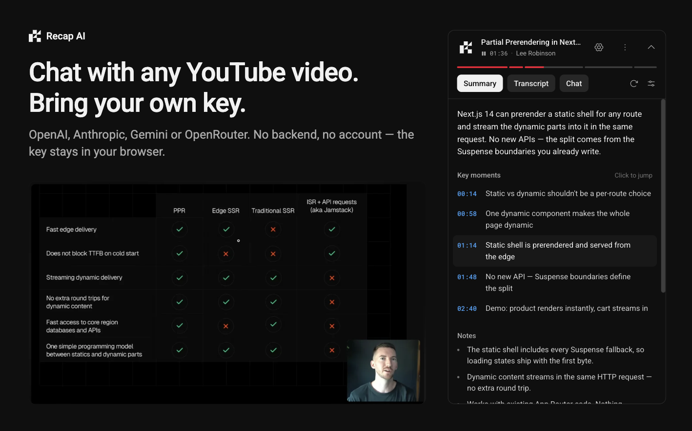

# Recap AI

Recap AI for YouTube: summaries, a searchable transcript and chat about the video, in the sidebar, powered by your own OpenAI, Anthropic, Google or OpenRouter key.



## Features

- Structured summary with key moments, notes, a plain-terms paragraph and a "current moment" marker that follows playback. Styles: Detailed, TL;DR and Key moments.
- Chapter bar under the header, synced to playback. Click a segment to jump. Videos without chapters get a single bar.
- Transcript that works without a key: search, follow playback, click to jump, chapter headers, copy.
- Chat with quotes from the transcript, a "Current moment" toggle, citation chips that seek the video, and per-video history.
- Starter questions generated from the summary.
- Bring your own key for OpenAI, Anthropic, Google or OpenRouter, with a model picker. The key is tested in the panel before it is saved.
- Usage counters for the month (tokens, summaries, chats).
- Auto-summarize (off by default), filler-word stripping, answer language and custom instructions.
- Text size (S, M, L) and theme (follow YouTube, dark or light).
- Export a video's summary and chat as Markdown, or all chats in one file.
- Shortcuts: `Alt+Y` toggle panel, `Alt+C` focus chat, `Alt+S` summarize, `Alt+F` search transcript. `Alt+Y` can be rebound at `chrome://extensions/shortcuts`.

## Install

From a release:

1. Download the zip from the [latest GitHub Release](https://github.com/PaoloJN/recap/releases/latest).
2. Unzip it.
3. Open `chrome://extensions` and turn on Developer mode.
4. Click Load unpacked and select the unzipped folder.

Or build from source, as described under Development, and load `.output/chrome-mv3` the same way.

## Setup

1. Open a YouTube video. The card shows "Add a key".
2. Click Add API key and pick a provider.
3. Paste your key and click Test key.
4. Click Save and continue.

Get a key here:

- OpenAI: https://platform.openai.com/api-keys
- Anthropic: https://platform.claude.com/settings/keys
- Google: https://aistudio.google.com/apikey
- OpenRouter: https://openrouter.ai/settings/keys

The transcript tab works without a key.

## Privacy

- Your key is stored in `chrome.storage.local` on your device and sent only to the provider you pick.
- Requests go only to YouTube and the provider you chose. There is no server of ours in between.
- No analytics, no telemetry, no tracking.
- Transcripts come from YouTube's own transcript feature. It is undocumented and may change. If it breaks, the panel shows "no transcript".

## Development

```sh
pnpm install
pnpm dev        # run the extension with hot reload
pnpm test       # unit tests
pnpm check      # lint and format (Biome)
pnpm typecheck
pnpm build
pnpm zip        # package into .output/
pnpm icons      # regenerate extension icons
```

## Tech stack

- [WXT](https://wxt.dev) for the extension framework
- React 19 and TypeScript
- Tailwind CSS v4 and shadcn/ui
- Phosphor icons
- Vercel AI SDK and Streamdown
- Biome for lint and format
- Vitest for tests

## License

See [LICENSE](LICENSE).
